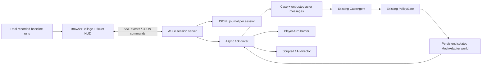

# План и архитектура

## Цель

Показать одновременно масштаб операционной работы и подробную историю одного решения: жильцы обращаются, агент читает доказательства, policy gate ограничивает действия, нужный человек получает следующий шаг.

## План реализации

1. **Контракт и источник правды.** Прочитать существующий loop, DecisionState, executor и MockAdapter. Сопоставить события без изменения поведения агента. Выполнено.
2. **Сессии и транспорт.** Один тикет — отдельный Case и сохраняемый между раундами mock-world. Журнал JSONL, один SSE-поток для всех тикетов, cursor и дедупликация при переподключении. Выполнено.
3. **Участники.** Игрок выбирает роль; остальные персонажи отвечают по conservative preset или через LLM director. Любой ответ добавляется как untrusted artefact. Операторские эскалации требуют человека. Выполнено.
4. **Живая деревня.** Шесть домов, четыре владельца, семь подрядчиков и четыре позиции Dwelly; карта, анимации, ответственность, параллельные истории и подробная панель тикета. Выполнено.
5. **Автономный показ.** Четыре импортированных реальных baseline-решения, скорость/пауза/пропуск, импорт и экспорт, service worker, локальные assets. Выполнено. Полные multi-turn golden episodes требуют нового live-прогона.
6. **Деплой.** Docker/Compose для Python, Cloudflare Tunnel для защищённого origin, статический `dist` для Pages, инструкция и stage script. Подготовлено; реальные облачные ресурсы не созданы.
7. **Проверка.** Unit/API/bridge tests без сети, browser QA desktop/mobile/projector. Результаты в VERIFICATION.md. Реальный вызов провайдера и Docker build требуют доступов/инструментов окружения.
8. **Money Intelligence.** Отдельная вкладка рядом с Village: source-linked ledger публичного корпуса, явно синтетический repeat-job portfolio, операционные метрики текущих сессий, contractor comparison, review queue, локальные отзывы и экспорт. Выполнено. Финансовая интеграция с настоящим record и командное хранилище отзывов описаны в INTELLIGENCE.md как следующие шаги.

## Компоненты

## Границы

Вид деревни общий, мир каждого тикета независим. Это позволяет параллельный показ разных экспериментов без влияния одного сценария на другой. Общая занятость подрядчиков, реальные арендаторы, настоящая отправка писем, платежи и production CRM в этот прототип не входят.

Сервис рассчитан на одну команду ведущих за Cloudflare Access. API не является публичным многопользовательским SaaS: авторизации по отдельным тикетам и изоляции между пользователями нет. Все реальные действия агента направлены исключительно в MockAdapter.

Веб-гайд Notion не удалось прочитать через доступный веб-инструмент. Его недоступное содержимое не использовалось для выдуманных требований.
