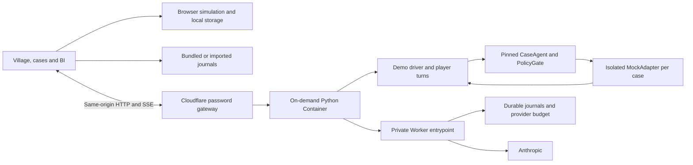

# Architecture and implementation status

For the saved version and restart steps, read [STATE.md](STATE.md). The active
prioritised backlog is [ROADMAP.md](ROADMAP.md); the 50-case analysis remains in
[CASE_REVIEW.md](CASE_REVIEW.md). This replaces the original implementation plan,
whose completed setup tasks and deployment assumptions are retained in Git history.

## Components

Local mode serves the same browser files directly from `demo.server`; it needs no
Cloudflare account. Static mode needs no Python API. Local and cloud deployment
limits differ: the cloud configuration allows one live session and scripted
participants; the local server supports configurable concurrency/directors.

## Completed foundation

- Real agent adapter, confirmed effect receipts, persistent per-round case context.
- HTTP commands, shared SSE cursor, deduplication, reconnect and JSONL export.
- Per-role human/automatic participants, independent cases and local simulation.
- Six-home village, Homes/People directories, attention signals, fullscreen view.
- Four authentic single-decision replays and three source-linked public simulations.
- BI evidence ledger, separate synthetic portfolio and local proposal feedback.
- Case Review UI-01/UI-02/UI-05 for the current scenarios.
- Static and Docker distributions; Cloudflare image/Worker deployment and login.

Paid-provider cloud behaviour is not yet verified. A completed round, a historical
case outcome and a successful browser simulation are different evidence.

## Boundaries

Cases use independent mock worlds. There is no shared contractor-capacity model,
real CRM, real email delivery or real payment. Live worlds are not resumable from
the journal after a process restart. Browser simulation state is local per origin.

Cloudflare viewers share password access, sessions and budget. There is no user-
level isolation. The alternative Compose/Tunnel deployment uses Cloudflare Access;
it is not the authentication mechanism of the current Workers deployment.

The external hackathon guide was not readable through the available tool during
initial implementation. Unread guide content was not used to invent requirements.
